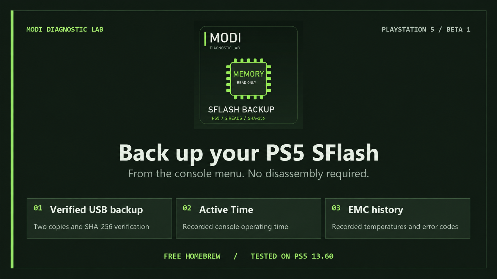
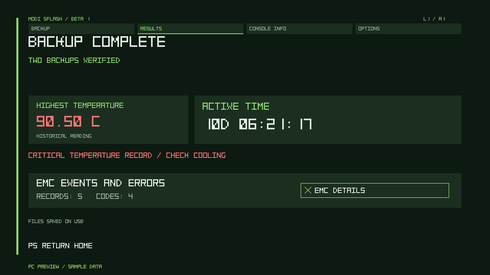
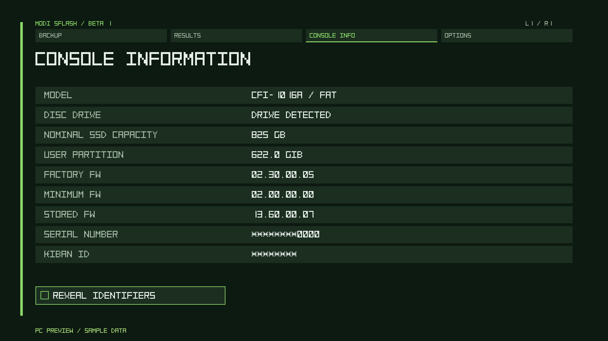

# MODI SFlash Beta 1

**A breakthrough in simplicity. Back up your PS5 SFlash before you mess with it.**

Got a jailbroken PS5? Press **X** to save two verified SFlash copies to USB. Then check how long your console has actually been active and see its available temperature and EMC error history. MODI SFlash is free homebrew.

**Language: [English](https://modyfikatorcasper.github.io/modi-sflash/?lang=en) · [Polski](https://modyfikatorcasper.github.io/modi-sflash/?lang=pl)**

**[Download Beta 1](downloads/MODI-SFlash-Beta-1.zip)** · **[Project page](https://modyfikatorcasper.github.io/modi-sflash/)** · [Checksums](downloads/SHA256SUMS.txt) · [Licenses and notices](downloads/LICENSES.txt)

## Start in four steps

Getting started with Relapse on **FW 13.60**.

1. Extract the ZIP, copy `MODI-SFlash-Beta-1.ffpkg` to the USB `homebrew` folder, and connect the writable USB drive to the PS5.
2. Run [Relapse](https://github.com/ntfargo/Relapse-Exploit) and wait for [elfldr](https://github.com/ps5-payload-dev/elfldr) on port **9021**. Load [kstuff-lite](https://github.com/EchoStretch/kstuff-lite) for your firmware, then [ShadowMountPlus](https://github.com/drakmor/ShadowMountPlus). If your host loads them automatically, wait for the app tile.
3. Open the **MODI SFlash** tile and press **X**. Keep the USB drive connected during the backup.
4. Wait for **VERIFIED** before removing the USB drive. Find the two copies, SHA-256 checksums, manifest and logs under `MODI_PS5_SFLASH_RO` on USB.

The engine is embedded in the application. **No separate ELF or payload-folder copy is needed.**

## What the app shows

- **Two verified copies:** independent reads, saved-file comparison and SHA-256 verification after closing and reopening the USB files. The source flash is opened read-only.
- **Active Time:** available recorded console operating time, displayed in days, hours, minutes and seconds. This is operating time, not a game-play counter.
- **EMC history:** available recorded temperatures and error events, with an expanded details window.
- **Console information:** available model, drive, storage and firmware information; identifiers are masked by default.
- **Options:** automatic language selection, manual PL/EN selection and two text styles.

The images are PC-rendered previews with clearly marked sample data, including sample thermal events. They are not measurements from an additional console.

## Console verification and pending targets

The MODI team reports the following console verification. **All completed console tests listed below used firmware 13.60.**

| Console | Model | Firmware | Status |
| --- | --- | --- | --- |
| FAT | CFI-1016 | 13.60 | Verified — reported by MODI |
| FAT | CFI-1116 | 13.60 | Verified — reported by MODI |
| Slim | CFI-2016 | 13.60 | Verified — reported by MODI |
| Slim | CFI-2116 | 13.60 | Verified — reported by MODI |
| PS5 Pro | Pending | 13.20 | Pending |

Additional firmware targets: **13.12 — Pending; 13.20 — Pending; 13.40 — Pending.** Pending does not mean compatibility is confirmed.

The embedded engine is identical to the engine independently checked against a completed 13.60 backup: both stored copies were 2 MiB and matched. The final Beta 1 frontend passed PC compilation/rendering checks; this exact frontend is not yet retested on a console.

High recorded temperatures can guide a cooling inspection and assessment of the thermal interface. Available records are not a guarantee of the highest lifetime temperature or proof that thermal material must be replaced.

## Planned programming tool

We plan to release a chip-programming tool for the community, to simplify writing a suitable, verified backup directly to a flash chip. The tool and recovery workflow remain in development. Physical-chip recovery using this app's backup has not yet been validated.

The app copies the SFlash image exposed by the console. SSD contents, game saves and optical-drive pairing recovery are outside the verified backup scope. A verified software read is not proof of full physical NOR coverage.

## Credits and notices

Created by **Modyfikator89 / ModyfikatorCasper**.

Thank you to the entire **PS5 homebrew community**, the developers and contributors behind Relapse, elfldr, kstuff-lite and ShadowMountPlus, and everyone who tested and shared feedback. Special thanks to **lewy20041** for getting us started with app development.

The application is free to download. Redistribution terms and required component notices are in [LICENSES.txt](downloads/LICENSES.txt). The download contains the application, instructions, licenses and checksums; it contains no private console data or application source.
