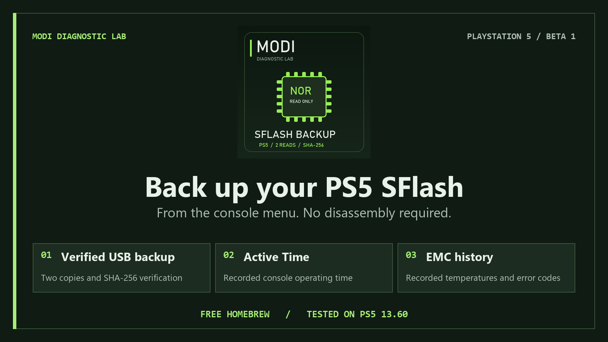

# MODI SFlash Beta 1

**A breakthrough in simplicity. Your PS5. Your backup. One press.**

Press **X** to save two verified SFlash copies to USB. Discover recorded console operating time and available thermal/error history in one easy-to-use, free homebrew app for hobbyists and repair diagnostics. Before experimenting with unfamiliar homebrew or system changes, preserve a verified SFlash reference for diagnostics and future recovery work.

**Language: [English](https://modyfikatorcasper.github.io/modi-sflash/?lang=en) · [Polski](https://modyfikatorcasper.github.io/modi-sflash/?lang=pl)**

**[Download Beta 1](downloads/MODI-SFlash-Beta-1.zip)** · **[Project page](https://modyfikatorcasper.github.io/modi-sflash/)** · [Checksums](downloads/SHA256SUMS.txt)

## Start in four steps

1. Extract the ZIP and put `MODI-SFlash-Beta-1.ffpkg` in the USB `homebrew` folder used by your ShadowMountPlus setup.
2. Start your already configured PS5 homebrew environment with **elfldr**, let **ShadowMountPlus** mount the application, and open its tile.
3. Keep the USB drive connected and press **X**.
4. Wait for **VERIFIED** before removing the USB drive. Find the two copies, SHA-256 checksums, manifest and logs under `MODI_PS5_SFLASH_RO` on USB.

The engine is embedded in the application. **No separate ELF or payload-folder copy is needed.**

## What the app shows

- **Two verified copies:** independent reads, saved-file comparison and SHA-256 verification after closing and reopening the USB files. The source flash is opened read-only.
- **Active Time:** available recorded console operating time, displayed in days, hours, minutes and seconds. This is operating time, not a game-play counter.
- **EMC history:** available recorded temperatures and error events, with an expanded details window.
- **Console information:** available model, drive, storage and firmware information; identifiers are masked by default.
- **Options:** automatic language selection, manual PL/EN selection and two text styles.

The images are PC-rendered previews with clearly marked sample data, including sample thermal events. They are not measurements from an additional console.

## Console verification and pending targets

The MODI team reports the following console verification. **All completed console tests listed below used firmware 13.60.**

| Console | Model | Firmware | Status |
| --- | --- | --- | --- |
| FAT | CFI-1016 | 13.60 | Verified — reported by MODI |
| FAT | CFI-1116 | 13.60 | Verified — reported by MODI |
| Slim | CFI-2016 | 13.60 | Verified — reported by MODI |
| Slim | CFI-2116 | 13.60 | Verified — reported by MODI |
| PS5 Pro | Pending | 13.20 | Pending |

Additional firmware targets: **13.12 — Pending; 13.20 — Pending; 13.40 — Pending.** Pending does not mean compatibility is confirmed.

The embedded engine is identical to the engine independently checked against a completed 13.60 backup: both stored copies were 2 MiB and matched. The final Beta 1 frontend passed PC compilation/rendering checks; this exact frontend is not yet retested on a console.

High recorded temperatures can guide a cooling inspection and assessment of the thermal interface. Available records are not a guarantee of the highest lifetime temperature or proof that thermal material must be replaced.

## Planned programming tool

We plan to release a chip-programming tool for the community, to simplify writing a suitable, verified backup directly to a flash chip. The tool and recovery workflow remain in development. Physical-chip recovery using this app's backup has not yet been validated.

The app copies the SFlash image exposed by the console. SSD contents, game saves and optical-drive pairing recovery are outside the verified backup scope. A verified software read is not proof of full physical NOR coverage.

## Credits and notices

Created by **Modyfikator89 / ModyfikatorCasper**.

Thanks to the **PS5 homebrew community**, all contributors, and **lewy20041** for introducing us to application development.

The application is free to download. Redistribution terms and required component notices are in [LICENSES.txt](downloads/LICENSES.txt). The download contains the application, instructions, licenses and checksums; it contains no private console data or application source.
